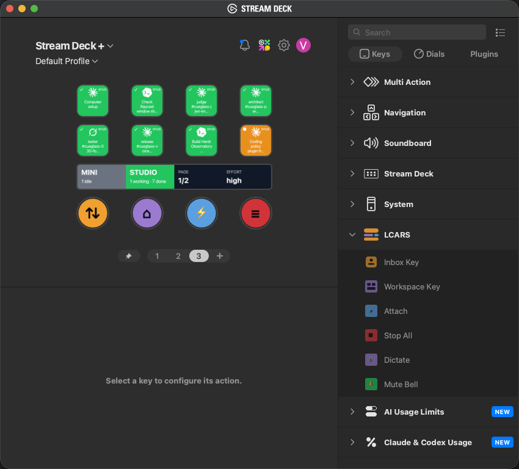
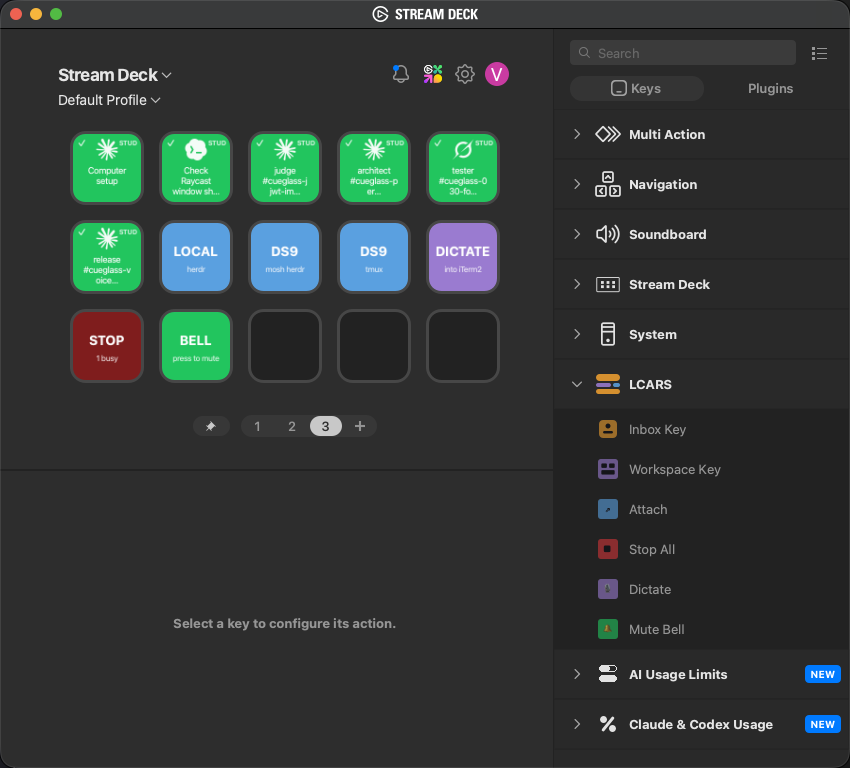

# LCARS

Stream Deck console for coding agents, backed by [Herdr](https://herdr.dev). The full design, decisions and build plan live in [docs/HANDOFF.md](docs/HANDOFF.md). Agent rules for this repo are in [AGENTS.md](AGENTS.md) (`CLAUDE.md` imports it). Changes per release: [CHANGELOG.md](CHANGELOG.md).

| Package | What | Stack |
| --- | --- | --- |
| `packages/ops` | Ops, the daemon. One Herdr socket per host, merged into one session list, serves the plugin | Rust (cargo workspace) |
| `packages/plugin` | LCARS, the Stream Deck plugin. Paints keys, dials and the touch strip; forwards presses to Ops | TypeScript, `@elgato/streamdeck` |

Recon notes on the Herdr socket API, with recorded frames as test fixtures: [docs/herdr-api.md](docs/herdr-api.md).

## Screenshots

Stream Deck XL, agent wall page: one key per agent across both hosts (host tag top-right, agent logo, state colour, pane title), workspace keys, the global keys and the third-party usage keys.


Stream Deck +: eight paged Inbox Keys, the fleet bar on the touch strip (one block per host, page and effort read-outs) and the four dials.



15-key MK.2, travel page: six Inbox Keys, Attach keys for the local Herdr and the remote host over mosh and tmux, Dictate, Stop All and Mute Bell.



## Status

| Milestone | State |
| --- | --- |
| 1. Recon of the Herdr socket API | done |
| 2. Ops v0: per-host event subscriptions, merged `FleetView`, loopback HTTP + WebSocket | done |
| 3. Plugin v0: Inbox Key on the Stream Deck +, tap focuses the pane | done |
| 4. Plus dials and touch strip | done |
| 5. Conn (long-press confirm), done ping | done; Claude Code hooks deferred (Herdr events are the signal) |
| 6. Remote and global keys | done on the XL; travel profile waits for the small deck |
| 7. XL status wall | done |
| 8. Packaging, launchd, install | done (agent load and skill link are explicit steps) |

## Requirements

- macOS, Stream Deck app 7.1+ (developed on 7.6), a Stream Deck +, XL or 15-key MK.2
- [Herdr](https://herdr.dev) 0.9.x on every host (protocol 22)
- Building from source: Rust stable (`cargo`), Node 20.5+, `npm i -g @elgato/cli` for packing or linking the plugin
- Remote hosts: SSH alias in `~/.ssh/config`, reachable over Tailscale

## Install

### From a release

Each [GitHub Release](https://github.com/gAmUssA/lcars/releases) carries `ops-vX.Y.Z-macos-arm64`, `io.gamov.lcars.streamDeckPlugin`, `install.sh`, the launchd plist template and `SHA256SUMS`. Ops, the plugin and the manifest share the release number.

```sh
shasum -a 256 -c SHA256SUMS                       # after downloading the assets into one folder
chmod +x ops-vX.Y.Z-macos-arm64 install.sh
open io.gamov.lcars.streamDeckPlugin              # the Stream Deck app installs it
./install.sh --binary ./ops-vX.Y.Z-macos-arm64    # ~/.local/bin/ops (quarantine stripped), ops.toml, plist (not loaded)
$EDITOR ~/.config/ops/ops.toml
launchctl bootstrap gui/$(id -u) ~/Library/LaunchAgents/io.gamov.lcars.ops.plist
```

### From source

From a fresh clone on the Mac the decks are plugged into:

```sh
make build            # cargo build --release + npm ci + plugin bundle
make install          # ~/.local/bin/ops, ~/.config/ops/ops.toml (if absent), launchd plist (not loaded)
$EDITOR ~/.config/ops/ops.toml   # one [[hosts]] block per machine
ssh -fNM -o ControlPath=~/.ssh/cm-<alias> -o ControlPersist=8h <alias>   # once per remote host, after login
make start            # loads io.gamov.lcars.ops: runs now and at every login
make pack             # packages/plugin/dist/io.gamov.lcars.streamDeckPlugin, double-click to install
```

`make status`, `make stop`, `make restart`, `make uninstall` manage the agent; Ops logs to `~/Library/Logs/lcars/ops.log`. `make install-skill` links the `lcars` Claude Code skill into `~/.claude/skills` so an agent can re-author deck pages later; see [docs/skill-install.md](docs/skill-install.md).

Every push to `main` also uploads `ops-macos-arm64` and `io.gamov.lcars.streamDeckPlugin` as workflow artifacts (Actions › CI).

Then lay out the decks in the Stream Deck app from the **LCARS** category, or let the skill write pages for you. macOS asks once for Automation consent the first time a key drives iTerm2.

## Supported agents

Ops shows whatever Herdr detects; the plugin draws a logo for the agents below and a two-letter code for anything else.

| Agent | Logo | Code | Agent | Logo | Code |
| --- | --- | --- | --- | --- | --- |
| Claude Code | yes | CL | Kimi | yes | KM |
| Codex | yes | CX | OpenCode | yes | OC |
| GitHub Copilot | yes | CP | Kilo | yes | KL |
| Cursor | yes | CU | Hermes | yes | HM |
| Devin | yes | DV | Qoder CLI | yes | QC |
| Droid | no | DR | Pi | yes | PI |
| Grok | yes | GK | OMP | yes | OM |
| Qwen Code | yes | QW | Letta | no | LT |
| Mastra Code | yes | MC | Antigravity CLI | yes | AG |

Claude Code-only controls (the Effort dial) act on Claude panes alone.

## Security model

- Ops listens on loopback only; `allow_remote_listen = true` is required to bind anything else, and the config refuses otherwise.
- Every endpoint except `/healthz` needs `Authorization: Bearer <token>`. Ops writes the token to `~/.local/state/ops/token` (mode 0600, `OPS_STATE_DIR` overrides) and the plugin reads it as the same user. Loopback is shared by every account on a Mac; the token is what keeps another local user from pressing keys in your agents.
- `send_keys` relays confirming keys (Enter and the like) only to a `blocked` session; Escape and Ctrl-C pass in any state. Conn in the plugin adds the long-press requirement on top.
- Actions on a disconnected host are refused with 503, and the keys dim so a stale colour is not mistaken for a reading.

## Build

```sh
cd packages/ops && cargo build && cargo test
cd packages/plugin && npm ci && npm run typecheck && npm test
```

## Run Ops

```sh
cd packages/ops
mkdir -p ~/.config/ops && cargo run -q -- --print-default-config > ~/.config/ops/ops.toml
# edit hosts, then:
cargo run -q
curl -s http://127.0.0.1:7677/sessions | jq .
```

Remote hosts ride an SSH ControlMaster you open once after login (1Password holds the keys, Ops never prompts):

```sh
ssh -fNM -o ControlPath=~/.ssh/cm-mini -o ControlPersist=8h mini
```

Ops logs to stdout; `RUST_LOG=ops=debug` for the subscription detail. Design record: [docs/adr/0001-ops-architecture.md](docs/adr/0001-ops-architecture.md).

## Run the plugin (development)

```sh
cd packages/plugin
npm ci && npm run build
streamdeck dev            # once: enables developer mode in the Stream Deck app
npm run link              # symlinks io.gamov.lcars.sdPlugin into the app
npm run restart           # after each build
```

Plugin logs land in `packages/plugin/io.gamov.lcars.sdPlugin/logs/`. The property inspector's **Ops address** is global and defaults to `http://127.0.0.1:7677`.

### Desktop banners

Set `[banners] enabled = true` in `ops.toml` (needs `brew install vjeantet/tap/alerter`) and Ops raises a macOS banner whenever an agent on any configured host blocks or finishes a turn you were not watching (Herdr `done`; a turn that ends in the focused pane stays quiet). The banner names the agent, project and host, and shows the blocked question when Ops read one. A click focuses the pane and reveals the iTerm session showing it. While banners are on, the [herdr-notify](https://github.com/gAmUssA/herdr-notify) plugin sees `X-Ops-Banners: on` on `/healthz` and stays silent. Only sockets listed in `ops.toml` are watched: give each named Herdr session its own `[[hosts]]` entry. Design: [docs/adr/0002-desktop-banners.md](docs/adr/0002-desktop-banners.md).

### Inbox Key

One Herdr agent pane per key, slot 1 = most urgent (blocked first, then most recently changed). Colour is the agent state (orange working, red blocked, green done, grey idle; `done` is a turn that finished while nobody was looking at the pane, cleared when it is focused), the badge is the agent kind, the corner tag is the host when more than one host is online, the text is the pane title, or the question the agent is asking while it is blocked. Short tap focuses the pane through Ops, which reveals the iTerm2 session showing it; iTerm2 is raised with AppleScript only when Ops could not (remote hosts). Long press is Conn, below.

### Conn and the done ping

- When an agent blocks, Ops reads its screen once and the key (and the ticker) show the question it is asking instead of the pane title.
- **Conn** is a long press (400 ms or more) on an Inbox Key whose agent is `blocked`: Ops presses Enter in that pane, which confirms whatever the agent's dialog has highlighted. A short tap never does this; a long press on a non-blocked key only blinks.
- **Done ping**: when an agent enters `blocked` or finishes a turn (`working` → `idle`), its key blinks and a system sound plays (Ping for blocked, Glass for done). The first view after a reconnect only primes the baseline. Mute with the **Bell** setting on any Inbox Key.

### Workspace Key

One Herdr workspace per key, ordered by host then Herdr's workspace number. Colour is Herdr's roll-up of the agents inside, the subtitle counts agents, a white ring marks the workspace that host's Herdr is showing. Press switches that host's Herdr to the workspace (`workspace.focus` via Ops) and raises iTerm2.

### Global keys

| Key | Press |
| --- | --- |
| Attach | opens an iTerm2 window running `herdr` locally, `ssh -t <alias> herdr`, `mosh <alias> -- herdr` or `ssh -t <alias> tmux attach` (host and mode per key) |
| Stop All | first press arms (SURE? with the busy count, 4 s); second press sends Escape to every working or blocked agent through Ops |
| Dictate | raises iTerm2 and clicks Edit › Start Dictation |
| Mute Bell | toggles the done-ping sound |

macOS asks once for Automation consent ("Stream Deck wants access to control iTerm" and "System Events") the first time Attach, Dictate or a focusing tap runs. Until you click Allow those keys show an alert.

### Dials and touch strip (Stream Deck +)

| Dial | Rotate | Press | Strip segment |
| --- | --- | --- | --- |
| 1 Scroll | page the Inbox Keys (8 per page) | back to page 1 | fleet bar |
| 2 Machine | cycle host filter: all → each host | show all hosts | fleet bar |
| 3 Effort | pick a Claude Code effort level (low … max) | send `/effort <level>` to the focused Claude pane | fleet bar |
| 4 Pane | scroll the focused pane's terminal (3 rows per tick); in ticker mode, cycle blocked agents | toggle fleet bar / inbox ticker | fleet bar |

The strip is one 800×100 scene sliced per dial. Fleet bar: one block per host coloured by its worst agent state with counts, tap a block to filter the keys to that host (tap again to clear); spare blocks show page and effort. Inbox ticker: the oldest blocked agent with its host and title, tap to focus it. The strip dims when Ops is unreachable.

### XL agent wall

The XL page "LCARS": rows 1–2 are 16 Inbox Keys in **wall** layout (slot n is the n-th agent across all hosts in Ops's order, blocked first, then most recent, no paging), row 3 is eight Workspace Keys, row 4 the global keys. New agents appear as soon as Ops sees their first status event; keys beyond the agent count stay black. The last two keys of rows 3 and 4 hold the third-party usage keys: Claude & Codex Usage (`com.singerous.ai-limits`) and AI Usage (`com.len.limits`), one Claude and one Codex key each. Those plugins ship encrypted manifests, so their keys are written as raw actions with the ids read from their bundled code.

### Travel deck (15-key MK.2)

Page "LCARS travel": six Inbox Keys in wall layout, Attach keys for the local Herdr and the remote host over mosh and tmux, Dictate, Stop All and Mute Bell. Three keys stay free.

### Deck layout

The Plus page "LCARS" (8 Inbox Keys, slots 1–8, plus the four dials) was written with [streamdeck-mcp](https://github.com/verygoodplugins/streamdeck-mcp)'s profile manager, which edits Elgato's `ProfilesV3` files directly and must quit and relaunch the Stream Deck app around the write. The XL and MK.2 pages were written the same way; the `lcars` skill carries the recipe.

## License

[MIT](LICENSE). Third-party notices for the plugin are in [packages/plugin/THIRD_PARTY_NOTICES.md](packages/plugin/THIRD_PARTY_NOTICES.md).
